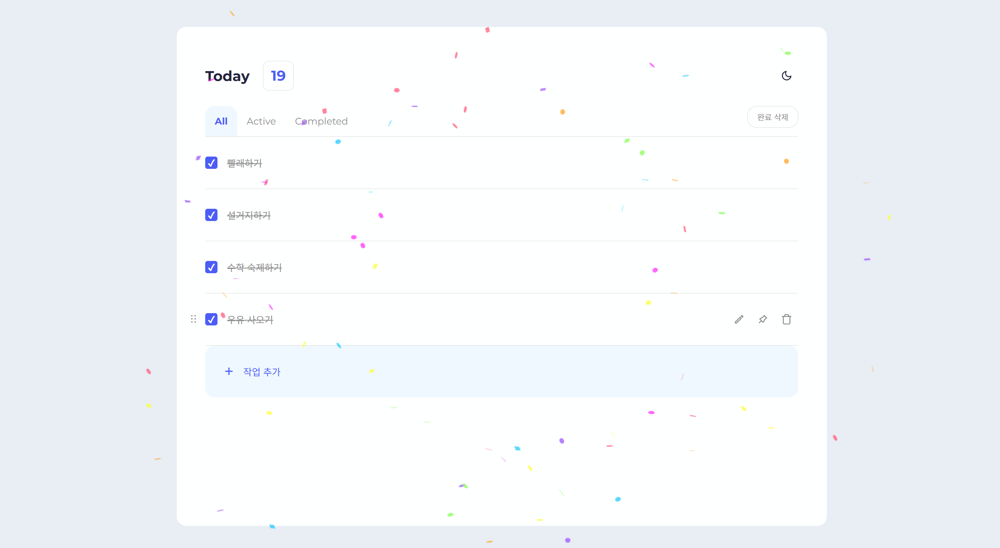
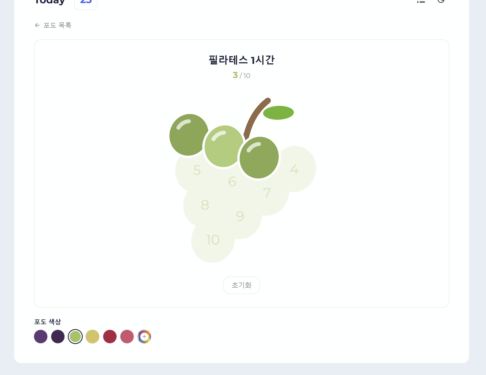
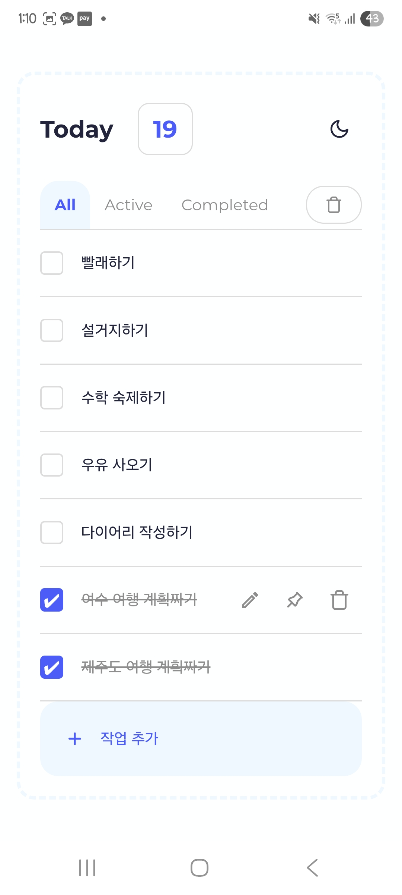

# ✅ [Today Log](https://today-log.netlify.app/)

> 오늘 하루를 기록하고 완성해가는 투두 웹 애플리케이션

---

## 📖 소개

**Today Log 앱**은 오늘 날짜를 기준으로 할 일을 빠르고 직관적으로 관리할 수 있는 웹 애플리케이션입니다.
모든 항목을 완료하면 컨페티 애니메이션으로 성취감을 느껴보세요 🎊

꾸준히 해내고 싶은 습관은 **포도알 모으기** 🍇 페이지에서 하루에 한 알씩 칠하며 포도 한 송이를 완성해보세요.

---

## 🛠 기술 스택

| 기술                                                                                                 | 설명                     |
| ---------------------------------------------------------------------------------------------------- | ------------------------ |
|                     | UI 컴포넌트 라이브러리   |
|         | 타입 안전성              |
|  | 페이지 라우팅            |
|                         | 빌드 도구                |
|             | 컴포넌트 스코프 스타일링 |

<br/>

---

## ✨ 기능 소개

### 오늘 날짜 표시

- 상단에 오늘 날짜(Today + 일자)를 실시간으로 표시

### 다크 모드

- 우측 상단 달 아이콘으로 다크/라이트 모드 전환
- `DarkModeContext`로 전역 상태 관리

### 할 일 추가

- 하단 `+ 작업 추가` 버튼으로 새 항목을 빠르게 등록

### 완료 처리

- 체크박스 클릭 시 완료 상태로 전환 (취소선 표시)
- 모든 항목 완료 시 🎊 컨페티 애니메이션 재생

### 인라인 편집

- 편집 아이콘 클릭 시 해당 항목이 인라인 텍스트 입력창으로 전환
- `수정 완료` 버튼으로 저장, `취소` 버튼으로 되돌리기

### 고정 / 삭제 / 드래그 & 드롭

- 항목 호버 시 고정(📌), 삭제(🗑) 버튼 표시
- 드래그 핸들(⠿)로 항목 순서 변경 가능
- 삭제 시 확인 모달을 띄움으로써 한 번 더 확인하고 제거

### 필터링

- All / Active / Completed 탭으로 원하는 항목만 필터링
- `완료 삭제` 버튼으로 완료된 항목 일괄 제거 (확인 모달 후 삭제)

### 확인 모달

- 삭제·초기화처럼 되돌릴 수 없는 작업 전에 확인 모달 표시
- `Esc` 키 또는 모달 바깥(어두운 배경) 클릭으로 닫기

### 포도알 모으기

- 헤더의 포도 / 목록 아이콘으로 투두 목록 ↔ 포도 페이지 전환
- `포도 추가`로 목표 이름, 포도알 개수(10 · 15 · 21 · 30 또는 3~50개 직접 입력), 포도 품종 색상 선택
- 입력하는 동안 포도송이 미리보기 제공
- 목록 카드에서 진행률 바와 `칠한 개수 / 전체 개수` 확인, 카드별 삭제 가능
- 상세 페이지에서 색상 변경 및 `초기화` 가능
- 포도 데이터는 `localStorage`에 저장되어 새로고침해도 유지

### 라우팅 / 404 페이지

- React Router로 `/`(투두), `/grape-list`(포도 목록), `/grape-list/:id`(포도 상세) 페이지 구성
- 존재하지 않는 경로 접근 시 404 페이지 표시 (이전 페이지 / 홈으로 가기)

### 반응형 디자인

- 데스크탑, 태블릿, 모바일 모든 화면 크기에 최적화
- CSS Modules 미디어 쿼리로 레이아웃 자동 조정

### 스켈레톤 ui 제공

- 로딩 시 스켈레톤 ui 제공하여 사용자 불편함 감소

<br/>

---

## 📸 스크린샷

### 기본 화면


> 오늘 날짜와 할 일 목록, 작업 추가 버튼이 깔끔하게 배치된 메인 화면

### 인라인 편집


> 편집 버튼 클릭 시 해당 항목이 즉시 입력창으로 전환되며, 수정 완료 / 취소 버튼으로 저장 여부를 선택할 수 있습니다

### 모두 완료 시 — 컨페티 🎊



> 모든 항목을 체크하면 컨페티 애니메이션이 화면을 가득 채웁니다

### 포도 투두 리스트



> 포도알을 클릭해 칠하고, 한 송이를 모두 채우면 🎊 컨페티 애니메이션이 실행됩니다.

### 다크 모드


> 우측 상단 달 아이콘 클릭 시 다크 모드로 전환되며, 선택한 테마는 유지됩니다

### 모바일 화면



> 모바일 화면에서도 레이아웃이 최적화되어 편리하게 사용할 수 있습니다

### 스켈레톤 UI


> 로딩 시 스켈레톤 UI를 제공합니다

<br/>

---

## 📁 프로젝트 구조

```
my-todo-app/
├── public/
│   └── screenshots
│   ├── logo.jpg
│   └── today-log-og-image.png
├── src/
│   ├── components/
│   │   ├── AddTodo/
│   │   │   ├── AddTodo.module.css
│   │   │   └── AddTodo.tsx
│   │   ├── ColorPicker/
│   │   │   ├── ColorPicker.module.css
│   │   │   └── ColorPicker.tsx
│   │   ├── ConfirmModal/
│   │   │   ├── ConfirmModal.module.css
│   │   │   └── ConfirmModal.tsx
│   │   ├── context/
│   │   │   └── DarkModeContext.tsx
│   │   ├── GrapeBunch/
│   │   │   ├── GrapeBunch.module.css
│   │   │   └── GrapeBunch.tsx
│   │   ├── GrapeDetail/
│   │   │   ├── GrapeDetail.module.css
│   │   │   └── GrapeDetail.tsx
│   │   ├── GrapeForm/
│   │   │   ├── GrapeForm.module.css
│   │   │   └── GrapeForm.tsx
│   │   ├── GrapeList/
│   │   │   ├── GrapeList.module.css
│   │   │   ├── GrapeList.tsx
│   │   │   └── grapes.ts
│   │   ├── Header/
│   │   │   ├── Header.module.css
│   │   │   └── Header.tsx
│   │   ├── NotFound/
│   │   │   ├── NotFound.module.css
│   │   │   └── NotFound.tsx
│   │   ├── ScrollToTop/
│   │   │   ├── ScrollToTop.module.css
│   │   │   └── ScrollToTop.tsx
│   │   ├── Todo/
│   │   │   ├── Todo.module.css
│   │   │   └── Todo.tsx
│   │   ├── TodoControls/
│   │   │   ├── TodoControls.module.css
│   │   │   └── TodoControls.tsx
│   │   ├── TodoForm/
│   │   │   ├── TodoForm.module.css
│   │   │   └── TodoForm.tsx
│   │   ├── TodoList/
│   │   │   └── TodoList.tsx
│   │   └── TodoSkeleton/
│   │       ├── TodoSkeleton.module.css
│   │       └── TodoSkeleton.tsx
│   ├── App.css
│   ├── App.tsx
│   └── main.tsx
├── .gitignore
├── eslint.config.js
├── index.html
├── package.json
├── tsconfig.app.json
├── tsconfig.json
├── tsconfig.node.json
├── vite.config.ts
└── yarn.lock
```
